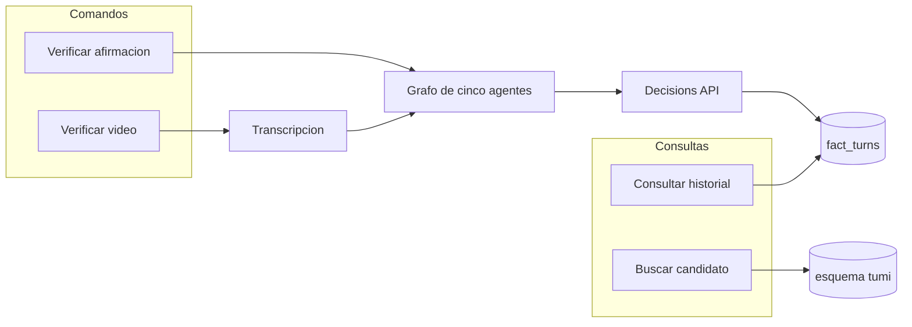

# TUMI

Monorepo para verificar afirmaciones electorales. Angular 22 habla con una API NestJS 12. LangGraph corre dentro de esa API. El veredicto lo clasifica la Decisions API de OpenAI (`gpt-6-luna`, el análogo de Jev). El modelo generativo solo redacta la explicación.

Sin `OPENAI_API_KEY` el stack arranca igual. La consulta queda en modo demostración, con veredicto `no_verificable` y sin probabilidades inventadas. Los candidatos salen de la base `goberlab` de tumi2 (rama qas), esquema `tumi`.

## Piezas

- `apps/web` — cortes `home`, `verify-claim`, `verify-video`, `candidates` e `history`
- `apps/api` — comandos y consultas. El grafo de cinco agentes vive en `commands/verify-claim`
- `apps/worker` — cola BullMQ. Indexa en Qdrant el PDF resumen del plan de cada lista.
- `packages/contracts` — tipos compartidos y umbral del veredicto
- `packages/database` — cliente Prisma sobre el esquema `tumi`

Infraestructura del Compose: Redis 8. Postgres y Qdrant van aparte. `DATABASE_URL` apunta a la base de QAS y `QDRANT_URL` al Qdrant externo.

## Local, con hot reload

Hace falta Docker y Node 22.22 o superior. La imagen de producción usa Node 24.22.

```bash
docker network create dokploy-network
copy .env.example .env
docker compose up redis -d
pnpm install
pnpm dev
```

La web queda en `http://localhost:4200` y proxyea `/api` hacia el puerto 3000.

Para cargar los PDF resumen de los planes en Qdrant:

```bash
pnpm --filter @tumi/worker build
node apps/worker/dist/index-plans.js
```

El comando retoma solo: si un expediente ya está en la colección, lo omite. El worker de Docker no empieza ese recorrido al arrancar. Para activarlo en el contenedor, define `INDEX_PLANS_ON_START=true`.

## Stack completo

```bash
docker network create dokploy-network
docker compose up --build
```

Abre `http://localhost:8080`. El API no se publica: nginx en `web` proxea `/api` y deja pasar el streaming.

## Dokploy

1. Crea un servicio Compose y apunta el Compose Path a `./docker-compose.yml`.
2. Pega las variables de `.env.example` en Environment. `DATABASE_URL` es la misma de tumi2 en qas. `QDRANT_URL` es el Qdrant externo y, si pide clave, `QDRANT_API_KEY`. También van `OPENAI_API_KEY`, `TAVILY_API_KEY` y, si aplica, `JNE_API_BASE_URL`.
3. En Domains, publica solo el servicio `web` en el puerto 80.
4. No definas `container_name`. Dokploy ya tiene la red `dokploy-network`.

## Variables

| Variable | Uso |
| --- | --- |
| `DATABASE_URL` | Postgres `goberlab` de tumi2, esquema `tumi` |
| `QDRANT_URL` | Qdrant externo. La colección `tumi_evidence` guarda fragmentos con `origen`, `codigoExpediente`, `sessionId` y `pagina` |
| `QDRANT_API_KEY` | Solo si ese Qdrant exige clave |
| `OPENAI_API_KEY` | Decisions, extracción, explicación y embeddings |
| `OPENAI_DECISION_MODEL` | Por defecto `gpt-6-luna` |
| `OPENAI_MODEL` / `OPENAI_MODEL_MINI` | Explicación y extracción |
| `DECISION_MIN_CONFIDENCE` | Bajo 0.55 el choice pasa a `no_verificable` |
| `TAVILY_API_KEY` | Búsqueda web. Si falta, se omite |
| `JNE_API_BASE_URL` | Adaptador HTTP opcional. Si falta, se usa Postgres |
| `AUTH_ENABLED` | `false` deja el acceso ciudadano abierto |

## Ruta de tesis

El aporte es una verificación trazable de afirmaciones electorales. El veredicto lo clasifica la Decisions API. El modelo generativo solo redacta la explicación. El video entra como un caso de uso más: convierte una pieza pública en afirmaciones con marca de tiempo y las pasa por el mismo grafo de cinco agentes.

La API separa escribir un veredicto de leer el padrón. Los comandos viven en `commands` y las consultas en `queries`. Redis, el guard de acceso y el límite de tasa quedan en `shared`.



### Diez pasos

1. **Cerrar la pregunta de tesis antes de seguir codeando.** La pregunta tiene que ser medible. Una formulación posible: si anclar cada veredicto a una evidencia y, en video, a un instante, reduce los veredictos inventados frente a un conjunto etiquetado a mano. Alcance: afirmaciones sobre candidatos y planes ya cargados en `goberlab`, texto y video público, veredictos `verdadero`, `falso`, `engañoso` y `no_verificable`. El umbral `0.55` que deja un choice débil en `no_verificable` forma parte de esa hipótesis.

2. **Nombrar los casos de uso con lenguaje de dominio.** Cinco capacidades: verificar afirmación, verificar video, buscar candidato, ver candidato y consultar historial. Cada una tiene entrada, salida y regla de negocio en `@tumi/contracts`. El contrato del video incluye la URL o el archivo, la transcripción, las afirmaciones y el segundo en el que aparece cada una.

3. **Reorganizar la API en cortes verticales.** Cada caso de uso queda en su carpeta, con su controlador, su handler y su prueba. El grafo (`identificacion` → `extraccion` → `recuperacion` → `verificacion` → `explicacion`) vive dentro de `commands/verify-claim`. Redis, Prisma, el guard de acceso y el límite de tasa se quedan en `shared`. La web sigue el mismo corte: `verify-claim`, `verify-video`, `candidates` e `history`.

4. **Separar comandos y consultas.** Un comando cambia estado: abre una `fact_session`, ejecuta el grafo y guarda el `fact_turn`. Una consulta solo lee: busca en `tumi.candidates` o lista turnos con `role = assistant`. El controlador de un comando no reutiliza el handler de una consulta. Event sourcing queda fuera de este alcance.

5. **Dejar el padrón como modelo de lectura y el historial como modelo de escritura.** `organizations`, `candidates`, `resumes` y `plan_proposals` viven en QAS y esta API no los modifica. `fact_sessions`, `fact_turns` y el esquema `langgraph` son lo que esta API escribe. Esa frontera va documentada en el C4 y coincide con sacar Postgres del Compose.

6. **Agregar Verificar video delante del grafo.** El ciudadano pega una URL pública o sube un clip corto. Un job de BullMQ, en el worker que ya existe, obtiene la pista de audio, transcribe con marcas de tiempo y parte el texto en afirmaciones. Cada afirmación entra al grafo con su `inicioSeg` y `finSeg`. La Decisions API sigue eligiendo el veredicto. Si no hay audio utilizable, el turno queda `no_verificable` y degradado, igual que una consulta sin clave de OpenAI.

7. **Mostrar el veredicto anclado al instante.** En el chat, cada afirmación del video se ve con el fragmento, el intervalo, el veredicto, la confianza y las fuentes. El reproductor abre ese segundo. El turno se guarda en el JSON que ya persiste `sources` y `choices`.

8. **Hacer cada veredicto auditable.** En el turno se guarda modelo de decisión, modelo de explicación, confianza, evidencias citadas, hash del prompt y, para video, el intervalo. Quien lea la tesis debe poder reconstruir por qué salió `engañoso` o `no_verificable`.

9. **Armar el experimento.** Etiquetar a mano un conjunto pequeño y declarado: afirmaciones de planes de gobierno ya cargados, más clips públicos cortos con el instante y el veredicto esperado. Medir acuerdo con esa etiqueta, si la cita sostiene el veredicto, cuántas veces el sistema se niega a juzgar, segundos por afirmación y costo por minuto de video. Reportar el tamaño de la muestra y el desacuerdo entre anotadores.

10. **Redactar la tesis sobre esa evidencia.** Arquitectura con los cortes y CQRS, diseño del pipeline de video, método del experimento, resultados, límites y ética. Solo video público o subido por el ciudadano. Se conserva la transcripción y las marcas de tiempo. Un veredicto automático no se presenta como calificación oficial del candidato.

### Corte objetivo

```text
apps/api/src/
  commands/
    verify-claim/
    verify-video/
  queries/
    search-candidates/
    view-candidate/
    consult-history/
    geo/
  shared/
```

Esa estructura ya está en `apps/api/src`. La web usa los mismos nombres de caso de uso en `home`, `verify-claim`, `verify-video`, `candidates` e `history`. Cada corte tiene su controlador y su handler. Los comandos (`verify-claim`, `verify-video`) escriben `fact_turns`. Las consultas (`search-candidates`, `view-candidate`, `consult-history`, `geo`) solo leen.

### Verificar video

El incremento actual acepta una URL pública de YouTube de hasta 4 minutos en `POST /api/verificar-video/stream`, o una transcripción pegada. El worker baja el audio y lo transcribe con marcas de tiempo. Cada afirmación pasa por el grafo de `commands/verify-claim`. La pantalla está en `/video` y el reproductor abre el segundo citado.

| Pieza | Responsabilidad |
| --- | --- |
| Comando | Recibe la URL o la transcripción, la parte y abre la sesión |
| Grafo existente | Identifica candidato, recupera plan y hoja de vida, verifica |
| Decisions API | `apoya`, `contradice`, veredicto y solidez por afirmación. Solo usa padrón, plan y medios |
| Circulación | Redes, blogs y Wikipedia se muestran aparte y no sostienen el veredicto |
| Consulta de historial | Devuelve las afirmaciones con su intervalo |

Leer texto en pantalla queda para el incremento siguiente.
